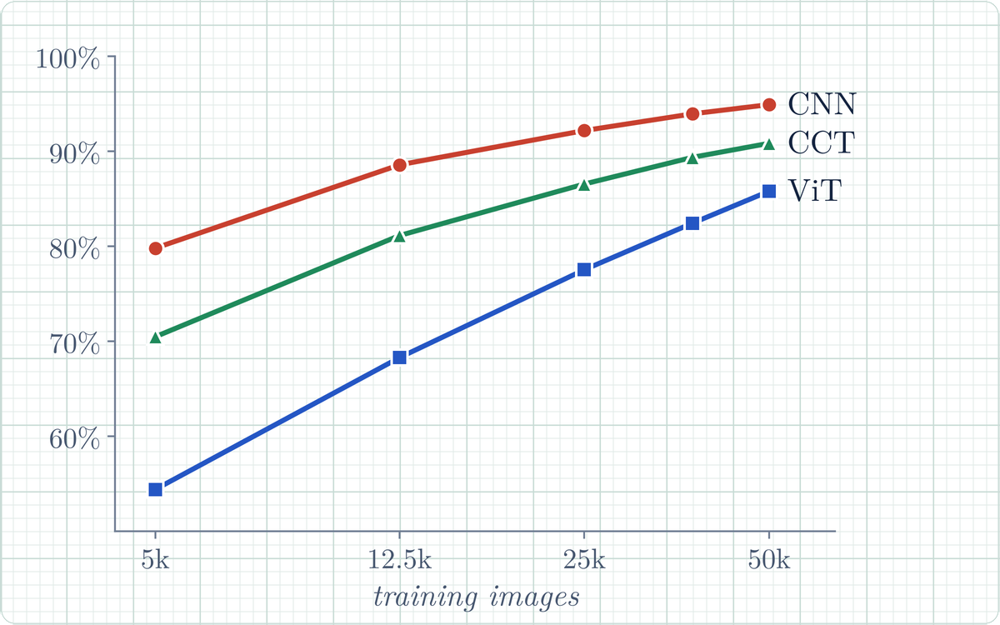
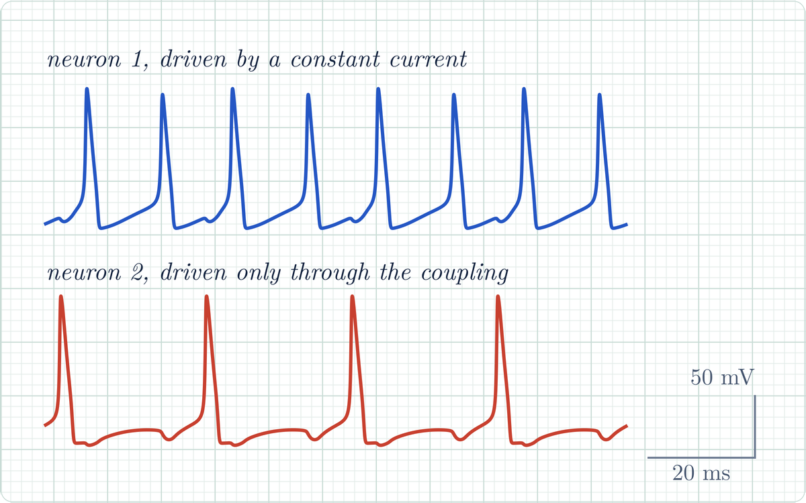
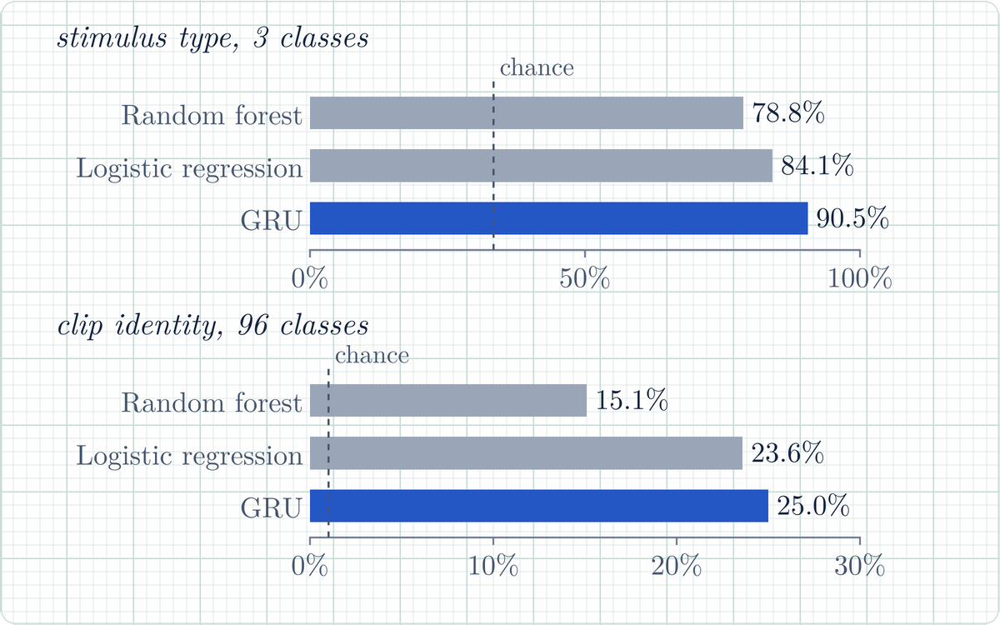
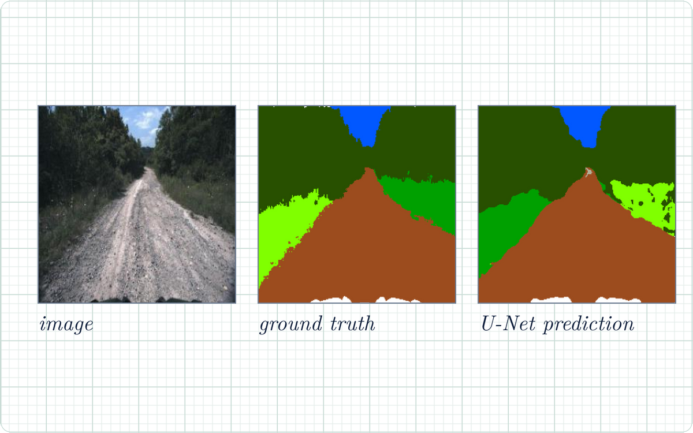
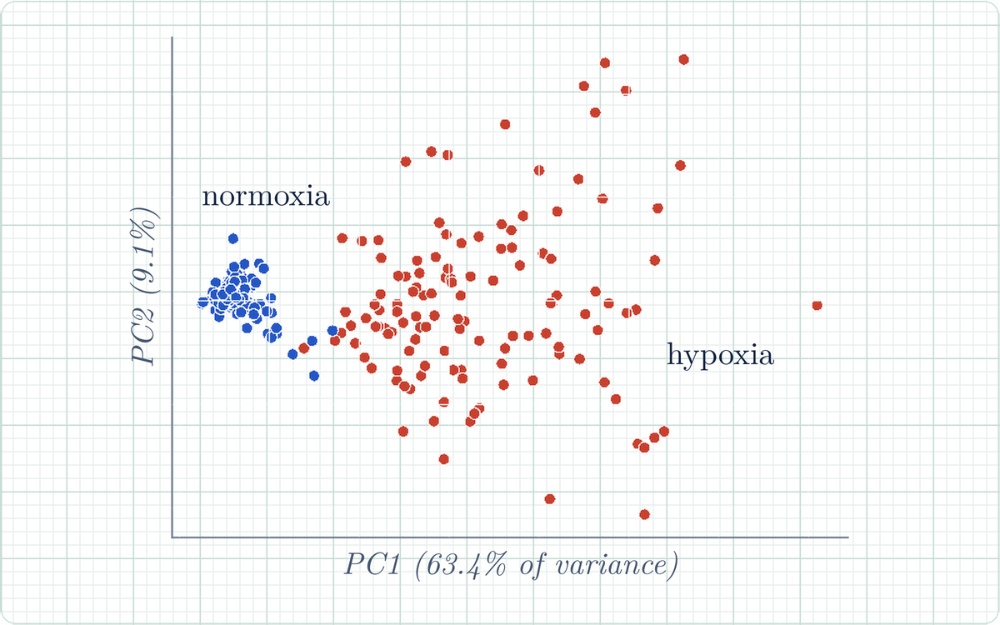
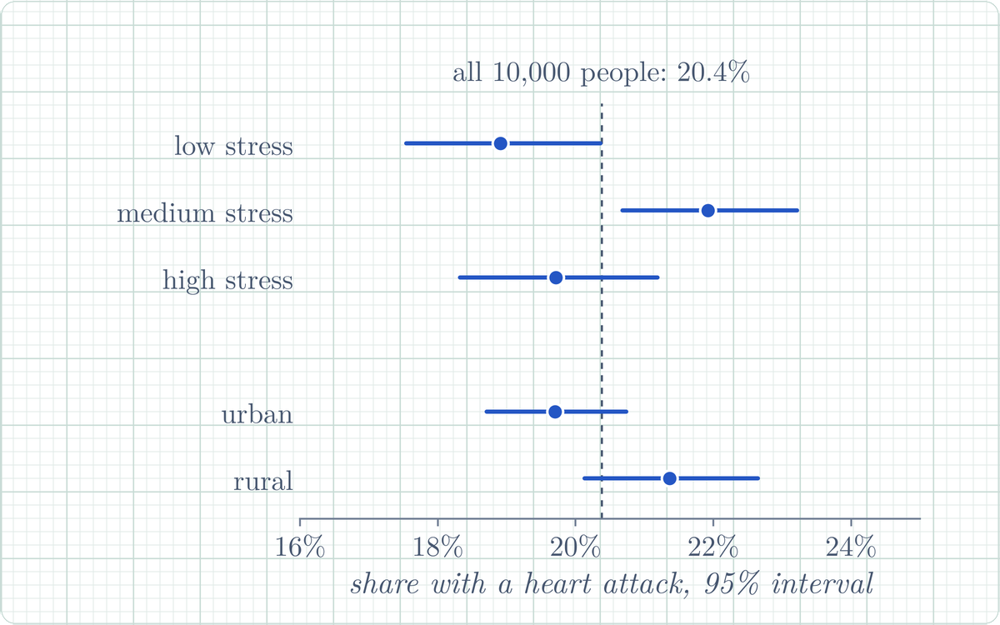

<picture>
  <source media="(prefers-color-scheme: dark)" srcset="assets/banner-dark.svg">
  
</picture>

 

I approach complex systems by bridging probability theory and numerical computation: building mathematical models, simulating their dynamics and testing them rigorously against data. So far this has meant recurrent network dynamics, numerical simulation of neuron models and statistical learning on high-dimensional data; next, stochastic analysis and its applications to quantitative finance.

**Research.** Attractor dynamics in binary recurrent networks, an undergraduate research project with Prof. Riccardo Zecchina and Prof. Nicolas Brunel at Bocconi. Bachelor's thesis in computational neuroscience with Prof. Brunel, in preparation.

## Selected work

<table>
<tr>
<td width="50%" valign="top">
<a href="https://github.com/trozki213/cnn-vit-cct-comparison"><picture><source media="(prefers-color-scheme: dark)" srcset="assets/cards/cifar-dark.png"></picture></a>
<h3><a href="https://github.com/trozki213/cnn-vit-cct-comparison">Inductive bias under data scarcity</a></h3>

A CNN, a Vision Transformer and a Compact Convolutional Transformer trained from scratch on CIFAR-10 at matched parameter budgets. With more data, the gap between the CNN and the ViT narrows from 25.4 to 9.1 points.

PyTorch, 60 controlled runs, CKA and linear probes
</td>
<td width="50%" valign="top">
<a href="https://github.com/trozki213/hodgkin-huxley-synchronization"><picture><source media="(prefers-color-scheme: dark)" srcset="assets/cards/hh-dark.png"></picture></a>
<h3><a href="https://github.com/trozki213/hodgkin-huxley-synchronization">Coupled Hodgkin–Huxley neurons</a></h3>

Single and electrically coupled neurons integrated with Euler, RK2 and RK4 schemes written from scratch: the onset of repetitive firing, coupling regimes and the cost of each solver.

NumPy, numerical ODE integration
</td>
</tr>
<tr>
<td width="50%" valign="top">
<a href="https://github.com/trozki213/microns-visual-decoding"><picture><source media="(prefers-color-scheme: dark)" srcset="assets/cards/microns-dark.png"></picture></a>
<h3><a href="https://github.com/trozki213/microns-visual-decoding">Decoding what a mouse sees</a></h3>

Calcium imaging of 7,493 neurons in four areas of mouse visual cortex (MICrONS). From V1 alone, a GRU decoder recognises the stimulus type 90.5% of the time, against a chance level of 33%.

PyTorch, scikit-learn, leakage-free splits
</td>
<td width="50%" valign="top">
<a href="https://github.com/trozki213/offroad-terrain-segmentation"><picture><source media="(prefers-color-scheme: dark)" srcset="assets/cards/offroad-dark.png"></picture></a>
<h3><a href="https://github.com/trozki213/offroad-terrain-segmentation">Off-road terrain segmentation</a></h3>

Nine-class semantic segmentation of off-road driving scenes with a U-Net, in a BSML team I led: dataset merging, near-duplicate removal and class-imbalance handling, up to 0.555 validation mIoU.

PyTorch, segmentation-models-pytorch
</td>
</tr>
<tr>
<td width="50%" valign="top">
<a href="https://github.com/trozki213/scrna-hypoxia-classification"><picture><source media="(prefers-color-scheme: dark)" srcset="assets/cards/scrna-dark.png"></picture></a>
<h3><a href="https://github.com/trozki213/scrna-hypoxia-classification">Hypoxia from single-cell RNA-seq</a></h3>

Do hypoxic and normoxic breast-cancer cells separate on their own? In MCF7 Smart-seq data spectral clustering recovers the two conditions with an adjusted Rand index of 0.95, and 50 genes are enough for over 95% accuracy.

scikit-learn, clustering, feature selection
</td>
<td width="50%" valign="top">
<a href="https://github.com/trozki213/heart-attacks-india-study"><picture><source media="(prefers-color-scheme: dark)" srcset="assets/cards/heart-dark.png"></picture></a>
<h3><a href="https://github.com/trozki213/heart-attacks-india-study">Heart attack risk in young adults</a></h3>

Logistic regression on 10,000 young adults in India. Single factors barely move the risk, so the model works with interactions; LASSO cuts it from 51 to 7 parameters with better AIC and BIC.

R, glmnet, likelihood-ratio tests
</td>
</tr>
</table>

## Other projects

- [**Fake news detection**](https://github.com/trozki213/fake-news-distilbert): DistilBERT fine-tuned to tell fake from real news articles, 95% test accuracy.
- [**Logistic regression vs k-NN**](https://github.com/trozki213/logreg-vs-knn-comparison): a tuned comparison on an imbalanced five-class problem, from exploration to ROC analysis.

## Toolbox

Python (NumPy, SciPy, pandas, scikit-learn, PyTorch), R, SQL, C, LaTeX and Git.

## Contact

[LinkedIn](https://www.linkedin.com/in/antonio-troiano-2231b2287/) or antoniotroiano2003@gmail.com

 

The header is drawn from a simulation: a Hodgkin–Huxley neuron driven by constant currents of 5.5, 6.2 and 6.3 µA/cm², integrated with RK4. Below 6.3 the neuron fires a few spikes and falls silent. The code is in [`tools/`](tools).
